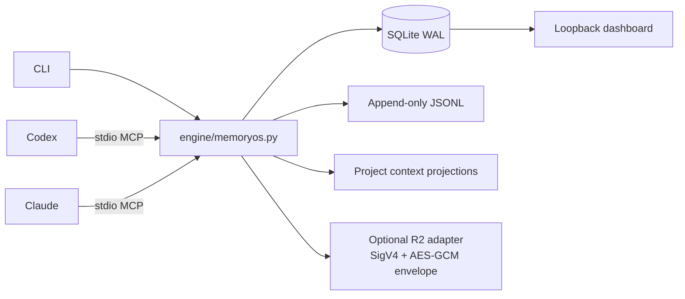

# Architecture

MEMORY OS is a local-first shared memory system: SQLite (authoritative) + append-only journal + filesystem projections, one stdio MCP engine for every agent, a loopback dashboard, and an optional Cloudflare R2 layer (off unless configured; additive-only sync; client-side AES-256-GCM with the versioned `MEMORYOS-R2-AESGCM-1` envelope; keys live in the macOS Keychain and never leave the machine). Intelligence: canonical categories, explainable importance scoring (ranking only — never deletion), idempotent capture with redaction, duplicate detection and safe consolidation, evidence-gated verification, version history, session summaries with auto-checkpoints, interrupted-session recovery, cycle-safe task dependencies, per-agent identity and history. Schema changes are additive and migration-serialized for concurrent agent startup. The PostgreSQL backend remains an isolated next-generation system until a verified migration path exists. ReverseLab and Hermes are separate and untouched.
